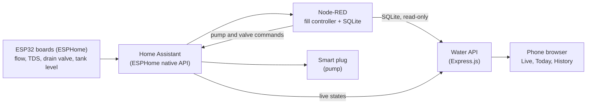
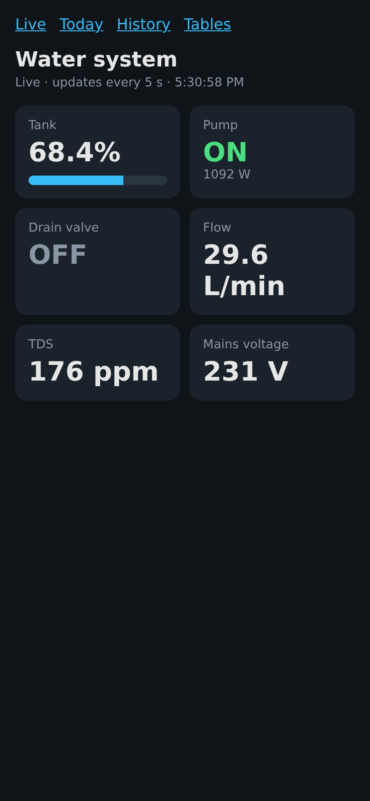
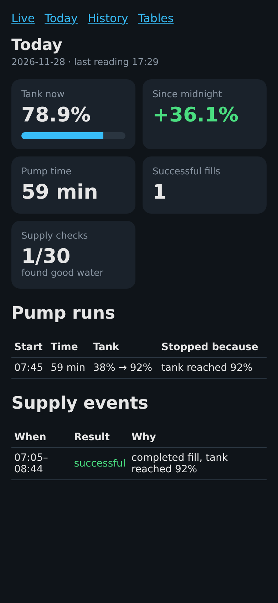
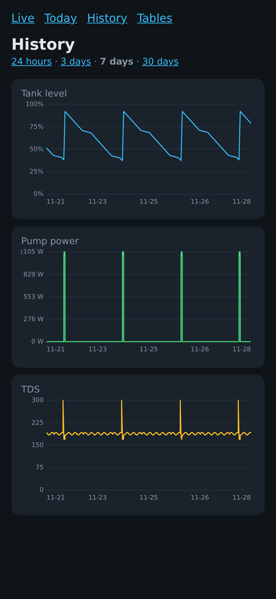

# Automated water supply and storage: stage 1

A residential water supply storage solution: rooftop tanks filled from a municipal supply that arrives every day or
two, for a few hours, often dirty at first. This repository is the first stage. One home runs the controller in
Node-RED on Home Assistant, and the Water API, a small Express.js app, showed its status on a phone.

## How it works



- The ESP32 boards report flow, TDS and tank level to Home Assistant over the ESPHome native API. There is no
  MQTT at this stage.
- Node-RED, running on Home Assistant, is the controller. It probes for supply with the drain valve, flushes dirty
  water to the drain, pumps only clean water to the tanks, and records everything in a SQLite database.
- The Water API reads that database (read-only) and Home Assistant's live states, and serves three phone pages
  and a JSON API.

## Screenshots

Demo data only: a made-up home with supply every other morning.

| Live | Today | History (7 days) |
|---|---|---|
|  |  |  |

## Where it sits

| Stage | What | Where |
|---|---|---|
| Foundation | Home Assistant + Node-RED controller for one home | this repository |
| **1** | **Express.js status page (Water API)** | **this repository, `water-api/`** |
| 2 | Single-home app: Python services, MQTT, time-series database | private (commercial), available on request |
| 3 | Multi-home app: dashboard for several homes | private (commercial), available on request |
| 4 | Water platform: one database per customer, admin portal | private (commercial), available on request |

**Why this stage.** The controller already ran in Node-RED, but the only views were the Home Assistant dashboard
and a Telegram bot. The Water API adds a plain phone page and a JSON API on top of the controller's own database,
without changing the controller.

**What came next, and why.** Everything here depends on one Home Assistant install in one home. The later stages
move the data and the controller into separate services over MQTT, so more than one home can be served. Those
stages are private (commercial), available on request.

## Tech

- ESP32 boards with ESPHome (`motor.yaml`, `tank.yaml`)
- Home Assistant OS, Node-RED (`node-red/flows.json`), SQLite
- Water API: Node.js 22, Express, Node's built-in SQLite module, Docker (as a Home Assistant app)
- Grafana dashboard (`grafana/`)

## Run it

- **Water API:** see [water-api/README.md](water-api/README.md). For a quick local try:

  ```sh
  cd water-api
  npm install
  WATER_DB=/path/to/water.db npm start   # then open http://localhost:3000/today
  ```

  The Live page needs Home Assistant; Today and History only need the database.
- **Controller:** import `node-red/flows.json` into Node-RED and flash the ESPHome files.
  [docs/home-system.md](docs/home-system.md) describes the controller, the hardware and the settings to fill in.

## Status

The controller still runs in one home in Node-RED (now v7.1). The Water API was retired from the home system in Nov
2026 and lives on as a demo. This repository is updated automatically from the live system (see `CHANGELOG.md`).
