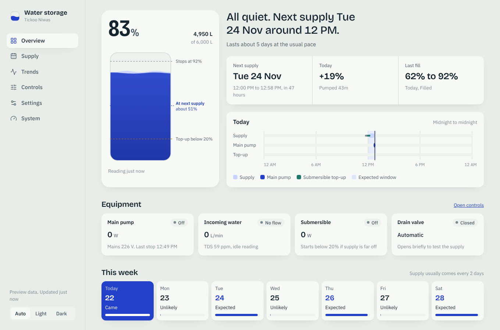
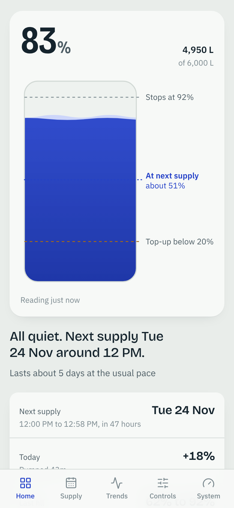
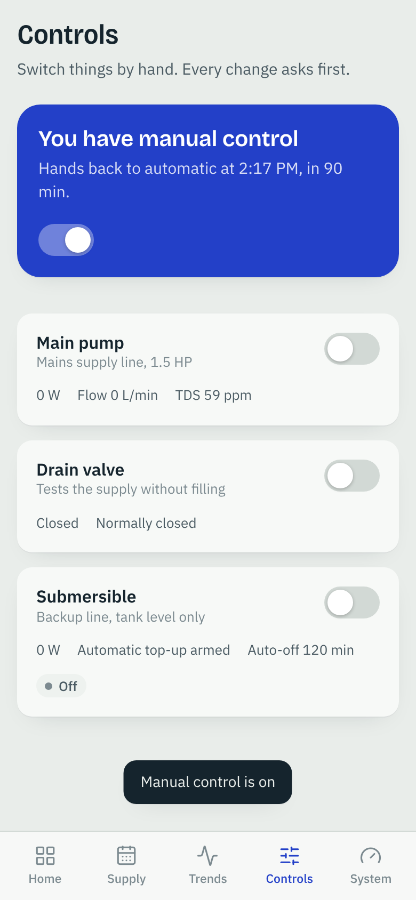
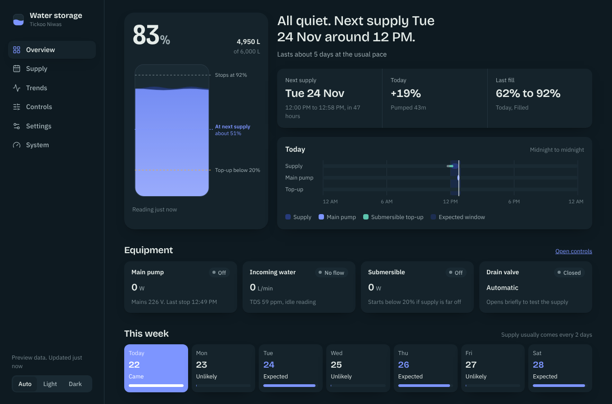
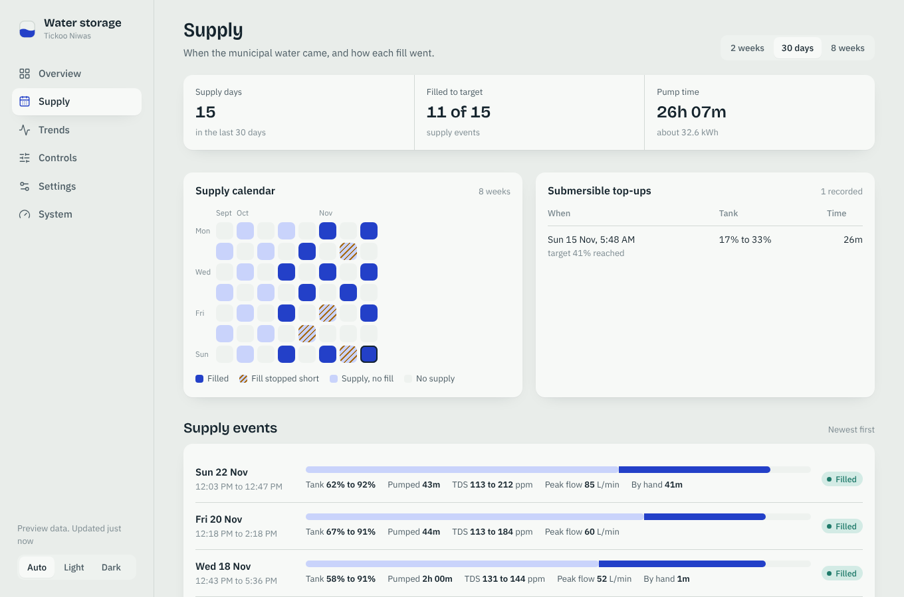

# Water API

[](https://github.com/deepeshtickoo/automation_water_storage/actions/workflows/water-api.yml)

The web app for the water supply storage solution. It shows how much water is in the tanks, when the next municipal supply is expected, how each fill went, and lets the household switch the pumps by hand. It runs as a local Home Assistant app next to Node-RED, on the home server.

The front end is React with TypeScript, built with Vite. The back end is Node.js 22 with Express and Node's built-in SQLite module, packaged as a Docker image that the Home Assistant Supervisor manages.



| Phone | Manual control | Dark |
|---|---|---|
|  |  |  |

*Screenshots use preview data modelled on the real records. Add `?demo` to the address to see the app the same way.*

## Screens

| Screen | What it shows |
|---|---|
| Overview | The tank as a live cross-section with its working marks (pump stop at 92%, top-up level, and the level expected when the next supply arrives), a one-line summary of what the system is doing, the next supply, today's activity on a 24-hour strip, equipment status and the 7-day supply forecast |
| Supply | A supply calendar for the last 8 weeks, every supply event with its tank change, pump time, TDS range and peak flow, and the submersible top-ups |
| Trends | Tank level, water quality, incoming flow and pump power for 24 hours to 30 days, with pump runs shaded |
| Controls | Manual control (hands back to the automatic system after 90 minutes), main pump, drain valve and submersible. Every switch asks first, and the pump and valve need manual control |
| Settings | The submersible top-up rules, editable, with a worked example, and the automatic system's rules in plain words |
| System | Device health, open alerts from the AI anomaly reviewer, AI usage, database size and the controller's recent activity |



## How it fits together

```
 ESP32 sensors ─┐
 Tapo plugs ────┴─> Home Assistant ─────────┐
                                            ├─> Water API (this app) ──> browser
 Node-RED controller ─┬─> water.db ─────────┤      React app + JSON API
                      └─> water-state.json ─┘
```

- **water.db** is the controller's SQLite database. The app opens it read-only, from a read-only mount; Node-RED stays the only writer.
- **Home Assistant** supplies live states and does the switching, through the Supervisor API (`homeassistant_api: true`), so no long-lived token is stored.
- **Node-RED** writes the controller's own state (current phase, open supply event, the 7-day forecast, the top-up state) to `/share/water-state.json` every 5 seconds. The app treats it as missing once it is two minutes old.
- **Settings** saved in the app go into a Home Assistant text helper (`input_text.water_backup_settings`). Node-RED watches it, checks the values again and applies them. No passwords or tokens are shared between the apps.

## JSON API

| Endpoint | Returns |
|---|---|
| `GET /api/v1/now` | Live snapshot: tank, flow, TDS, pumps, valve, manual control, controller state, forecast, top-up state |
| `GET /api/v1/today` | Today's readings, pump runs, top-ups, supply checks and events (Indian Standard Time day) |
| `GET /api/v1/history?hours=72` | Readings averaged down to at most 600 points, plus pump runs, up to 90 days |
| `GET /api/v1/events?days=56` | Supply events, the daily supply record, daily summaries and top-ups |
| `GET /api/v1/system` | Device health, open alerts, controller log, AI and database counts |
| `GET/POST /api/v1/settings` | Submersible top-up settings, range-checked on the way in |
| `POST /api/v1/control` | `{ "target": "pump" \| "valve" \| "sub" \| "manual", "on": true }`. The pump and valve refuse to switch on unless manual control is on |
| `GET /api/health` | Version and whether the web app is installed |

The older `/api/live`, `/api/history`, `/api/tables` and `/api/table/:name` still work, and the old `/live`, `/today` and `/history` pages now open the matching screen.

## Design notes

- One visual idea carries the app: the tank. Everything around it stays quiet, with a limestone and cobalt palette, Bricolage Grotesque for figures and headings and IBM Plex Sans for text. Fonts are bundled, so the app works on the home network without internet.
- Light and dark themes follow the phone, with a manual override.
- Copy is written for the household, not for engineers: "Next supply Tuesday around 12 PM", "Lasts about 5 days at the usual pace".
- Charts are hand-drawn SVG with no chart library, and the server thins readings before sending them, so the whole app is about 90 KB of script over the wire.
- Keyboard focus is visible, motion is limited to the water itself and respects reduced-motion settings, and dialogs become bottom sheets on phones.

## Running it

```bash
# API, against a copy of the database
WATER_DB=./water.db WATER_PASSWORD=secret npm start

# Web app with hot reload, proxying /api to the server above
cd web && npm ci && npm run dev

# Web app on preview data only
open "http://localhost:5173/?demo"

# Tests (server) and type-check plus build (web)
npm test
cd web && npm run build
```

`npm run build` writes the app to `public/` and a `manifest.json` listing its files. The Docker image includes `public/`. On the home server a newer copy can be dropped into `/share/water-web` (the Node-RED Water Tools tab has an installer that downloads it from this repository), and `/share/water-api.js` overrides the bundled server, so updates need only an app restart.

## Login

Set a username and password in the app's Configuration tab to turn on HTTP Basic auth for every page and endpoint. Leave the username empty to accept any username with the right password. Comparisons are constant-time.
