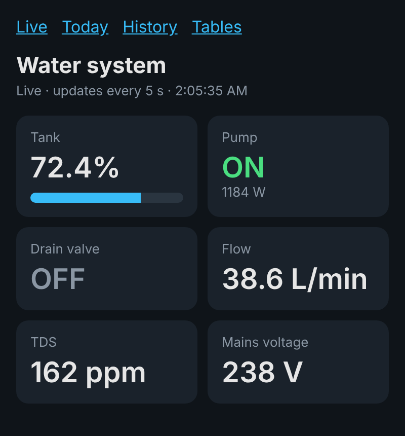
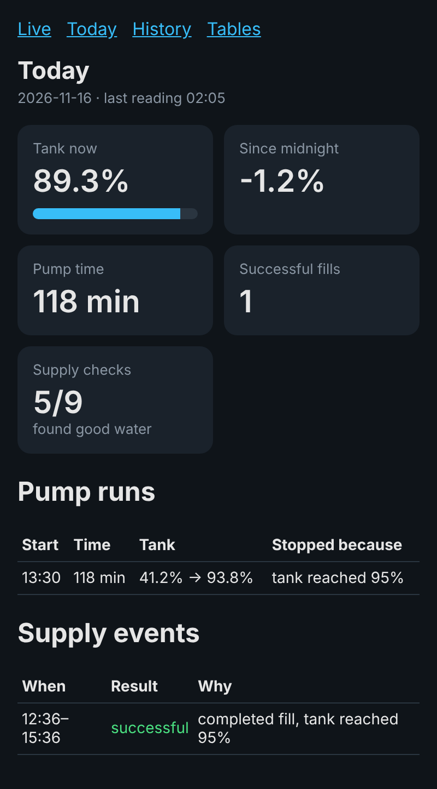
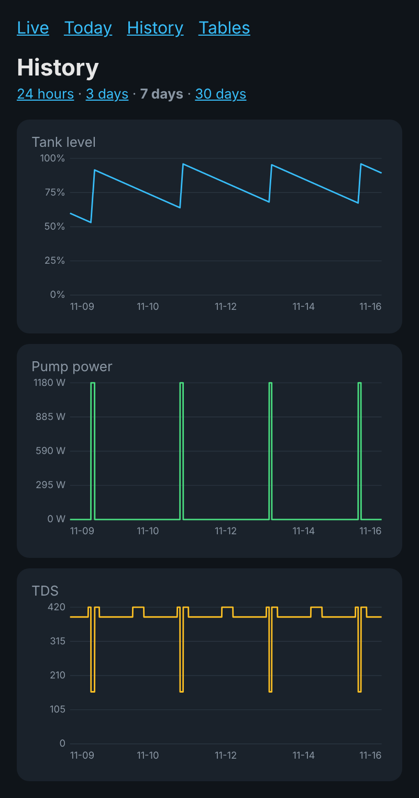

# Water API

A small read-only web API and phone dashboard for the water supply storage solution. It runs as a local Home Assistant app (add-on) next to Node-RED, reads the controller's SQLite database and Home Assistant's live sensor states, and never writes to either.

Built with Node.js 22, Express and Node's built-in SQLite module, packaged as a Docker container managed by the Home Assistant Supervisor.

| Live | Today | History |
|---|---|---|
|  |  |  |

*Screenshots use sample data.*

## Pages

| Page | What it shows |
|---|---|
| `/live` | Tank level, pump on/off and watts, drain valve, flow, TDS and mains voltage, straight from Home Assistant, refreshed every 5 seconds |
| `/today` | Tank now and change since midnight, pump time, successful fills, supply checks that found good water, today's pump runs and supply events |
| `/history` | Tank level, pump power and TDS charts for the last 24 hours, 3 days, 7 days or 30 days (server-drawn SVG, no chart library) |
| `/` | Every table in the database, each linking to its latest rows as JSON |

## JSON API

| Endpoint | Returns |
|---|---|
| `GET /api/live` | Current sensor and switch states from Home Assistant |
| `GET /api/today` | Today's summary (Indian Standard Time day) |
| `GET /api/history?hours=24` | Minute readings (tank, pump watts, TDS), up to 30 days |
| `GET /api/tables` | Table names |
| `GET /api/table/:name?limit=50` | Latest rows of one table (max 500) |

## How it is built

- **Read-only by design.** The database is opened with `readOnly: true` and mounted read-only into the container. The Node-RED controller stays the only writer.
- **Live data** comes from the Home Assistant REST API through the Supervisor (`homeassistant_api: true`), so no long-lived token is stored.
- **Login.** Set a username and password in the app's Configuration tab to turn on HTTP Basic auth for every page and endpoint. Leave the username empty to accept any username with the right password. Comparisons are constant-time.
- **No rebuild for code changes.** The image only holds Node and Express. At start the container runs `/share/water-api.js` if it exists, otherwise the bundled `server.js`, so editing the shared file and restarting the app is enough. Dependencies are installed in their own Docker layer, so rebuilding is quick too.

## Install

1. Copy this folder to the Home Assistant `addons` share (Samba share or Studio Code Server), for example `addons/water-api/`.
2. Settings → Apps → App Store → ⋮ → Check for updates, then install **Water API** from the local apps section.
3. Optional: set a username and password in the Configuration tab.
4. Start it and open `http://homeassistant.local:3000/live`.
5. To edit the code without rebuilding, copy `server.js` to `share/water-api.js`, edit it there and restart the app.

Change the database path (`WATER_DB`) and the entity IDs at the top of `server.js` to match your setup.
